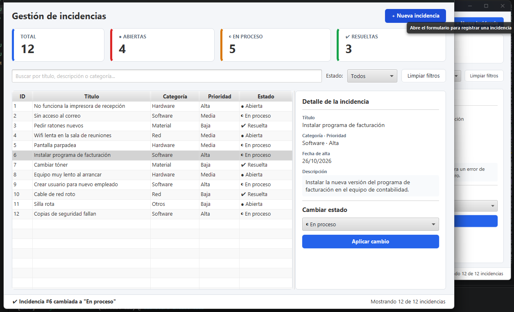

# Dashboard de Gestión de Incidencias

Aplicación de escritorio desarrollada en JavaFX para la gestión de incidencias de una empresa.
Permite ver cuántas incidencias hay, su estado, prioridad y una breve descripción.
Se pueden filtrar por texto y por estado, y también registrar nuevas incidencias.



## <ins>Funcionalidades</ins>

**Indicadores:** Muestra el total de incidencias, y cuántas están abiertas, en proceso y resueltas.

**Listado:** Muestra una tabla con todas las incidencias.

**Detalle:** Al hacer clic en una incidencia se muestran todos sus datos.

**Búsqueda por texto:** Puedes buscar por título, descripción o categoría, y filtrar por estado.

**Cambio de estado:** Al seleccionar una incidencia puedes actualizar su estado.

**Alta de incidencia:** Al crear una incidencia se valida que estén todos los campos obligatorios.

**Mensaje de confirmación:** Al realizar cualquier acción aparece un mensaje abajo a la izquierda indicando el cambio.

## <ins>Requisitos</ins>

**JDK 25 o superior** (probado con JDK 27).

**Maven 3.9 o superior.**

**Git** para descargar el proyecto.

**Scene Builder** para editar `dashboard.fxml` (opcional).

JavaFX no hace falta instalarlo: Maven descarga automáticamente la versión 27.

**Enlaces de descarga:**

- **JDK:** https://www.oracle.com/java/technologies/downloads/
- **Maven:** https://maven.apache.org/download.cgi
- **Scene Builder:** https://gluonhq.com/products/scene-builder/

## <ins>Cómo ejecutarlo</ins>

```bash
git clone https://github.com/CarlosVP98/dashboard-incidencias.git
cd dashboard-incidencias
mvn javafx:run
```

## <ins>Notas</ins>

La aplicación no usa base de datos: arranca siempre con una lista de incidencias de ejemplo y los cambios se pierden al cerrarla.

Más información sobre el diseño del proyecto en la carpeta [`docs`](docs).
